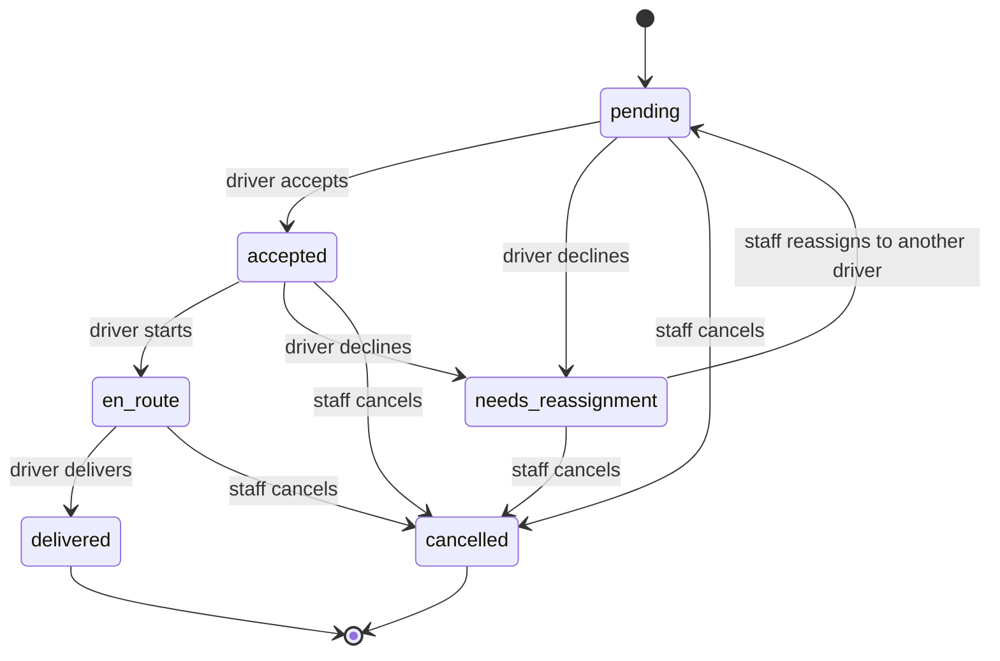

# Design decisions

Why FreightPath is built the way it is. Use this together with the [ERD](ERD.md) and the [database notes](DATABASE_ADMIN.md).

## Key decisions

| Decision | Why | Trade-off |
|---|---|---|
| One `users` table with a `role_id`, plus a separate `drivers` profile | Everyone logs in the same way; only drivers need license and phone data. Avoids copying names and emails. | A driver needs two rows, so creating one runs inside a transaction. |
| Roles checked by route middleware (`role:admin,dispatcher`) and by ownership checks in the controller | The route list shows at a glance who can open what; drivers can only open their own trips. | Policies would be the more standard Laravel tool for the ownership rule. |
| Admin creates drivers; self-registration gives the `driver` role with no profile | Drivers should not create their own company accounts. A self-registered account has the least power and cannot open any staff page. | An admin must still create the driver profile. Registration can be switched off with a setting. |
| Status can only move forward (`Schedule::NEXT`), and drivers advance it while staff can only cancel | Keeps the history truthful: a trip cannot jump from pending to delivered, and the dispatcher cannot mark a delivery the driver did not make. | A dispatcher cannot fix a mistaken status; they cancel and recreate. |
| Every status change writes a row to `delivery_status_logs` inside the same transaction | The timeline and Trip history are real records with who, when, and a remark. | `schedules.status` repeats the latest status on purpose (see the ERD notes). |
| A declined trip takes effect immediately (no approval step) | A sick driver at 5 AM cannot wait for approval. The dispatcher's job is to find a replacement, and the system records and flags late declines. | The system cannot stop a driver from declining. It gives managers the data (decline counts, late flag) instead. |
| Reassignment is an offer: the trip goes back to Pending and the new driver must accept | A replacement who is caught off guard can say no, and the accept time is a record that they agreed. | One more tap for the new driver. |
| Availability is decided by time overlap, not by today's status | Dispatchers must plan ahead, including for a driver who is on the road today. | Overlap checks need a query; they are also backed by partial unique indexes. |
| Rules in the database as well as in the application (CHECK constraints, triggers, partial unique indexes) | If the app has a bug or someone uses SQL directly, the data stays valid. | The same rule exists in two places and must be kept in step (tests check both). |
| Three database roles (owner, app, read-only) and two Laravel connections | The running app cannot change the schema. Only migrations, seeding, and tests use the owner. | Slightly more setup, handled once by `setup.sql`. |
| Trip history is a separate page; finished trips leave the Schedules page and become read-only | The Schedules page stays a short to-do list, and history cannot be edited (enforced by a trigger). | Corrections are not possible after the fact. |
| Drivers get a simplified, large-text interface | Drivers may be older and use a phone outdoors. One big action at a time, plain words, confirmation before each step. | Staff and drivers see different views of the same trip. |

## Trip status flow

When a trip becomes `en_route`, the truck and driver become `on_trip`. When it is delivered or cancelled they become `available` again,
but only if they were `on_trip`, so a truck in maintenance or a driver off duty is never overridden.

## Who can do what

| Action | Admin | Dispatcher | Driver |
|---|---|---|---|
| View drivers and trucks | yes | yes | no |
| Create, edit, delete drivers and trucks | yes | no | no |
| Create and edit trips; reassign a trip | yes | yes | no |
| Delete a trip (pending only) | yes | yes | no |
| Cancel a trip | yes | yes | no |
| View all trips and Trip history | yes | yes | no |
| View own trips | n/a | n/a | yes |
| Accept, start, and deliver own trip | no | no | yes |
| Decline own trip (pending or accepted) | no | no | yes |
| Dashboard | staff dashboard | staff dashboard | driver home |

## Scheduling rules

A trip is rejected when:

- the departure is in the past, or the arrival is not after the departure;
- the driver is off duty or the truck is in maintenance;
- the driver's license expires before the departure date;
- the driver or the truck already has a pending, accepted, or en-route trip that overlaps in time (back-to-back trips are allowed).

Starting a trip is refused when the truck is in maintenance, the driver is off duty, or the driver or truck is already on another trip.
Only pending trips can be deleted. Finished trips, and trips on the road, cannot be edited.

## Known limitations

- **Not built yet (Capstone):** the ESP32 + NEO-6M + SIM800L tracker, GPS tracking with regularly updated location data, the map, route visualization, and the approaching-destination indicator.
  The tracker sends readings at intervals and stores them when there is no signal, so the map shows the last known position, not a continuous live position.
- No notifications (SMS or push); the dispatcher sees flags on the dashboard and the Schedules page.
- A trip cannot be handed over once it is on the road; staff cancel it and create a new one.
- The status flow is enforced by the application. The database blocks edits to finished trips and a second trip on the road, but not an out-of-order jump such as pending to delivered.
- Authorization is in the application only (no PostgreSQL Row Level Security).
- Backups are manual, with no schedule.
- English only; a Filipino interface is a possible improvement.
- Automated tests cover the main rules, but not every screen and not the browser interface.

## Defense questions

### COMP 016 Web Development

**Walk through one request.** See the "How a request flows" section of the [README](../README.md): route, middleware, controller, model, view.

**What is mass assignment and how do you protect against it?** `Model::create($request->all())` would let a user set any column, including `role_id`.
Our models list `$fillable` columns, and `role_id` is set on the server (for example `Role::firstOrCreate(['name' => 'driver'])`), never from form input.

**Where is validation?** In the controllers (`$request->validate(...)`). Rules that need the database (overlaps, license date, availability) are in `ScheduleController::validated()`.

**Why a transaction when creating a driver?** The login account and the profile are two rows. In `DB::transaction`, either both are saved or neither is.

**How do roles work?** The `users.role_id` column points to `roles`. The `EnsureUserHasRole` middleware compares the logged-in user's role with the roles listed in the route and returns 403 if it is not allowed.

**How does `migrate:fresh --seed` work with two database roles?** `AppServiceProvider` switches the default connection to the owner role for `migrate*`, `db:seed`, and `db:wipe`.

**Why does a new registration get the driver role?** It is the least-privileged role. The account cannot open any staff page until an admin creates a driver profile.

**How do you prevent double-booking?** An overlap query when saving, plus partial unique indexes so the database refuses two en-route trips for the same driver or truck.

### COMP 018 Database Administration

**Why is it in 3NF?** See the [ERD notes](ERD.md#normalization): roles, driver profiles, trucks, and status history each live in their own table, and the one deliberate repetition (`schedules.status`) is explained.

**Why three roles?** The app role cannot create or alter tables, and the read-only role cannot change data. Show `permission denied` for both (see the database notes, section 1).

**What does your trigger do?** `protect_finished_trips` runs before any update on `schedules` and refuses the change if the trip is delivered or cancelled. `block_log_updates` keeps the status history append-only.

**Why a CHECK constraint instead of an enum or lookup table?** The statuses are fixed by the program logic, so a CHECK constraint is simpler than extra tables and still rejects invalid values.

**What is a partial unique index?** An index over only the rows that match a condition. Ours covers only `status = 'en_route'`, so a driver can have many trips overall but only one on the road.

**Show and explain an EXPLAIN plan.** See the database notes, section 4: a Seq Scan on a tiny table, the index forced with `enable_seqscan = off`, and the planner choosing the index by itself with 5,000 rows.

**How do you back up and restore, and how do you know the restore worked?** `pg_dump -Fc` to a file, `pg_restore` into a separate database, then compare row counts.

**What does the view do and who can use it?** `active_schedules` joins four tables into the dispatcher's list of unfinished trips. The app role and read-only role can only read it.

**Where are the Laravel connection settings?** `config/database.php` (the `pgsql` and `pgsql_owner` connections) and `.env`.

## Who explains what

Every member should be able to explain their own part. Fill in the names.

| Area | Key files | Member |
|---|---|---|
| Login, roles, and route protection | `routes/web.php`, `EnsureUserHasRole`, `LoginRequest`, `RegisteredUserController` | [name] |
| Drivers, trucks, validation, dashboards | `DriverController`, `TruckController`, `DashboardController`, forms | [name] |
| Trips: scheduling rules, status flow, decline and reassign, history | `ScheduleController`, `Schedule` model, `TransactionController` | [name] |
| Database administration: roles, constraints, trigger, indexes, backup | `setup.sql`, `database/migrations/`, `backup.bat`, `restore.bat`, `docs/DATABASE_ADMIN.md` | [name] |

## 10-minute demo checklist

1. `php artisan migrate:fresh --seed`, then log in as admin and show the dashboard.
2. Add a driver (show validation with a duplicate license) and a truck.
3. Assign a trip (show an overlap being rejected).
4. As Maria (private window): accept, start, and deliver the trip. Show the truck and driver status changing.
5. As admin: open Trip history and the timeline of the finished trip.
6. As Maria: decline a trip with a reason; as the dispatcher, reassign it to Pedro.
7. Show a 403 (a driver opening `/drivers`) and the login tab check.
8. Database: show the roles and `permission denied` as the app and read-only roles.
9. Show the trigger blocking an edit of a delivered trip, and an EXPLAIN plan.
10. Run the backup, restore it, and compare the row counts.
