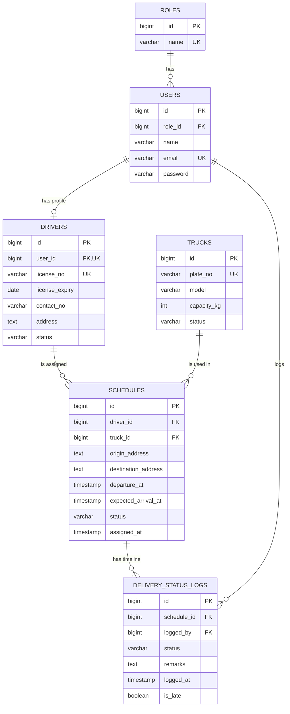

# Entity-relationship diagram and data dictionary

Laravel's own tables (`sessions`, `cache`, `jobs`, `password_reset_tokens`, `migrations`) are not shown.

## ERD

All tables also have `created_at` and `updated_at` except `delivery_status_logs`, which has `logged_at` instead.

## Relationships

| Relationship | Rule |
|---|---|
| role to users (1 to many) | A user has exactly one role. A role cannot be deleted while users have it (`ON DELETE RESTRICT`). |
| user to driver (1 to 0 or 1) | A driver profile belongs to exactly one login account (`UNIQUE user_id`). Deleting the user deletes the profile (`CASCADE`). |
| driver to schedules (1 to many) | A driver with trips cannot be deleted (`RESTRICT`), so history is never lost. |
| truck to schedules (1 to many) | Same protection for trucks (`RESTRICT`). |
| schedule to status logs (1 to many) | Deleting a (pending) trip also deletes its timeline (`CASCADE`). |
| user to status logs (1 to many) | Records who made each change (`RESTRICT`). |

## Data dictionary

**roles**: `id`, `name` (unique: admin, dispatcher, driver).

**users**: `id`, `role_id`, `name`, `email` (unique, the login), `password` (hashed), plus Laravel's `email_verified_at` and `remember_token`.

**drivers**: `id`, `user_id` (unique), `license_no` (unique), `license_expiry` (date), `contact_no` (20), `address`,
`status` (`available`, `on_trip`, `off_duty`, default `available`).

**trucks**: `id`, `plate_no` (unique, 20), `model`, `capacity_kg` (integer), `status` (`available`, `on_trip`, `maintenance`, default `available`).

**schedules**: `id`, `driver_id`, `truck_id`, `origin_address`, `destination_address`, `departure_at`, `expected_arrival_at`,
`status` (`pending`, `accepted`, `en_route`, `needs_reassignment`, `delivered`, `cancelled`, default `pending`),
`assigned_at` (when the current driver was offered the trip).

**delivery_status_logs**: `id`, `schedule_id`, `logged_by`, `status` (same values as schedules), `remarks`, `logged_at`, `is_late` (a decline made close to departure).

## Constraints enforced by the database

| Table | Constraint |
|---|---|
| drivers | `drivers_status_check`: status is one of the three allowed values |
| trucks | `trucks_status_check`: status is one of the three allowed values |
| schedules | `schedules_status_check`: status is one of the six allowed values |
| schedules | `schedules_time_check`: `expected_arrival_at > departure_at` |
| delivery_status_logs | `logs_status_check`: status is one of the six allowed values |

## Normalization

The design is in **third normal form (3NF)**.

- **1NF:** every column holds one atomic value (no lists in a column); every table has a primary key.
- **2NF:** every table has a single-column key, so no column depends on only part of a key.
- **3NF:** non-key columns depend only on their own table's key, and nothing depends on another non-key column:
  - Role names live in `roles`, not repeated on every user.
  - A driver's name and email live in `users`, not copied into `drivers`; `drivers` holds only what is specific to a driver (license, phone, address, status).
  - Truck details live in `trucks`; a trip only stores `truck_id`.
  - The history of status changes is a separate table, so `schedules` does not need repeating columns such as `picked_up_at` and `delivered_at`.

**One deliberate trade-off:** `schedules.status` repeats the status of the latest log entry. We keep it on purpose so the
Schedules page can filter and count by status quickly (it is indexed), and the application updates both in a single transaction.
The log table is the full history; the column is the current state.

**Statuses as CHECK constraints instead of lookup tables:** the allowed statuses are fixed by the application's logic,
so a CHECK constraint keeps the schema simpler than three extra lookup tables while still stopping invalid values.
If statuses ever needed to be edited by users, we would move them to lookup tables.
